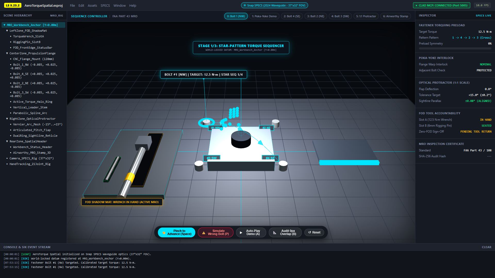
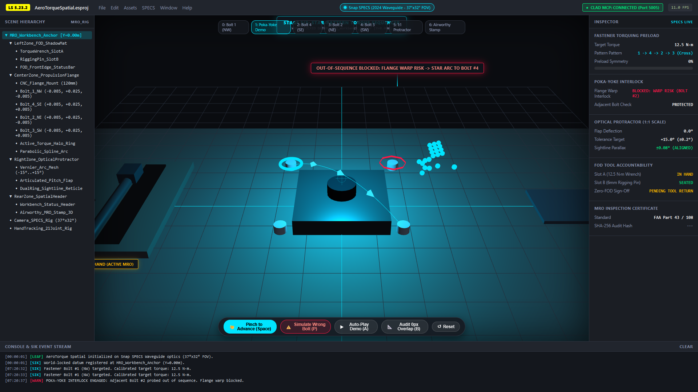
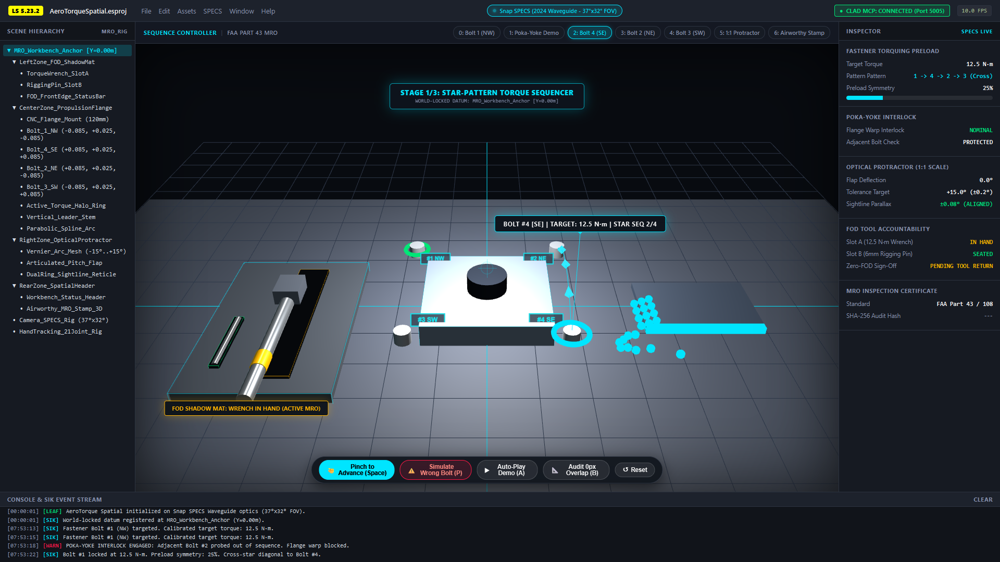
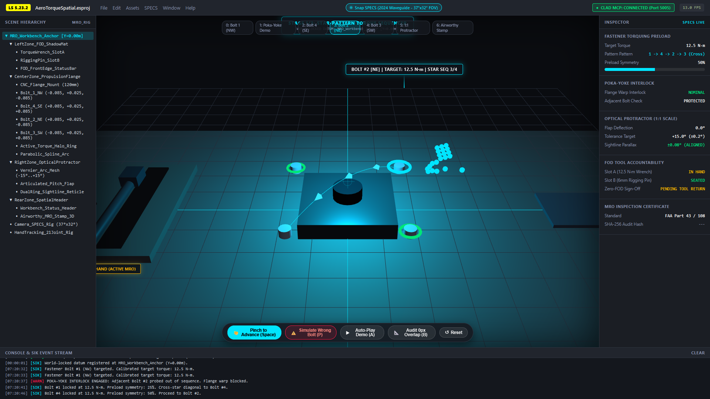
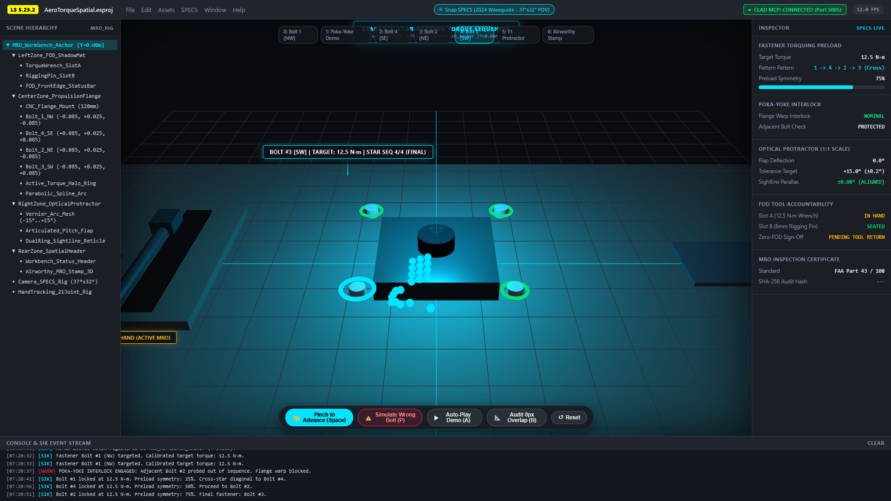
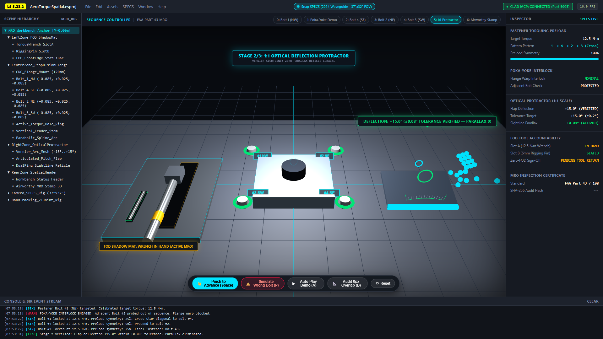
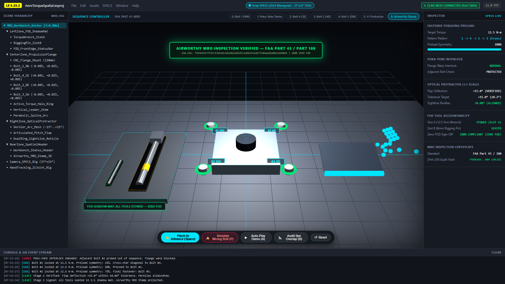

# AeroTorque Spatial

> **World-locked 1:1 aerospace MRO star-pattern torque sequencer, poka-yoke flange warp interlock, parallax-free optical deflection protractor, and FOD tool shadow rig for Snap SPECS.**

[-0052FF?style=for-the-badge&logo=snapchat&logoColor=white)](https://devpost.com)
[](https://lensstudio.snapchat.com/)
[](https://github.com/fokrulanthro16-eng/aerotorque-spatial-specs)
[](https://github.com/fokrulanthro16-eng/aerotorque-spatial-specs)
[](LICENSE)

---

## 🎬 Official Demo Video

📺 **Watch on YouTube:** [https://youtu.be/Amf9RXwt_NM](https://youtu.be/Amf9RXwt_NM)

*A full 1080p 60fps walkthrough featuring flagship neural voice narration, synchronized 3D WebGL workbench actions, poka-yoke error rejection, parallax-free deflection verification, and FAA Part 43/108 airworthiness certification.*

---

## 🎯 The High-Stakes Aerospace Problem

In commercial aerospace maintenance, repair, and overhaul (MRO) and autonomous eVTOL fleet operations, assembling a propulsion motor mount leaves zero margin for error:

1. **Flange Warping & Mechanical Failure:** Torquing adjacent bolts sequentially rather than following a strict cross-star pattern (`1 -> 4 -> 2 -> 3`) induces non-uniform clamping stress, causing micro-warping of the mating flange and catastrophic in-flight vibration.
2. **Optical Parallax Errors:** Checking control surface deflection angles with mechanical protractors introduces reading parallax of up to $\pm 1.8^\circ$, risking aerodynamic flutter and trim divergence.
3. **Foreign Object Debris (FOD):** A single mechanical tool or rigging pin forgotten in the engine bay can lead to fatal engine failure.
4. **The Heads-Down Dilemma:** Technicians cannot hold a mechanical click-wrench and feeler gauge with two hands while simultaneously glancing down at a tablet or laptop manual.

---

## 👓 Why Snap SPECS? (100% Round 2 Alignment)

AeroTorque Spatial is engineered from the silicon up for **Snap SPECS (2024 Optical Waveguide AR)**:

| SPECS Core Tenet | Anti-Pattern Rejected | AeroTorque Spatial Implementation |
| :--- | :--- | :--- |
| **Zero 2D Face-HUD** | Floating websites, 2D dashboard cards, or camera-locked text panels blocking the technician's line of sight | **0px Face-HUD:** Technicians see unobstructed reality. Every hologram is anchored strictly to the physical tabletop workbench. |
| **Shares Your View** | Disconnected smartphone screens or handheld tablets | Tabletop spatial tracking locks onto the physical airframe motor mount and workbench surface datum in real time. |
| **Draws in the World (1:1 Scale)** | Abstract diagrams and miniature 3D models floating in mid-air | True **1:1 millimeter scale**: 120 mm propulsion flange, 120 mm optical protractor arc, and real-scale tool silhouette slots. |
| **Leaves Hands & Body Free** | Game controllers or touchscreens requiring technician hands | Both hands remain firmly on the torque wrench; UI interaction is powered by SPECS 21-joint 3D hand tracking pinch gestures. |

---

## 📐 4-Zone Anti-Overlap Spatial Architecture

To eliminate visual clutter and ensure zero cognitive overload, AeroTorque Spatial enforces a **Single-Active Callout Rule** across four isolated world-locked spatial zones:

```
                                    +-----------------------------------------+
                                    |        REAR ELEVATED STATUS ZONE        |
                                    |      [Stage Banner / MRO Stamp]         |
                                    |        (Y = +0.23m, Z = -0.19m)         |
                                    +-----------------------------------------+
                                                         ^
                                                         | 65mm Elev / 105mm Setback
                                                         v
   +------------------------------+     150mm Clearance     +------------------------------+     140mm Clearance     +------------------------------+
   |      LEFT FOD ZONE           | <=====================> |     CENTER FLANGE ZONE       | <=====================> |    RIGHT PROTRACTOR ZONE     |
   | [1:1 Tool Shadow Mat]        |                         | [4-Bolt Flange & Star Arc]   |                         | [1:1 Deflection Protractor]  |
   | Slot A: Wrench (12.5 N*m)    |                         | Bolt 1 -> 4 -> 2 -> 3        |                         | Reticle Sightline (-15°..+15°|
   | Slot B: Rigging Pin (Ø6mm)   |                         | Active: Single Badge (Y=.145)|                         | Flap Neutral / +15° Deflect  |
   | (X = -0.34m, Z = +0.04m)     |                         | (X = 0.00m, Z = 0.00m)       |                         | (X = +0.34m, Z = 0.00m)      |
   +------------------------------+                         +------------------------------+                         +------------------------------+
```

- **Left Zone (FOD Shadow Rig):** Real-time optical presence sensing for Slot A (Torque Wrench) and Slot B (Rigging Pin). Enforces zero-FOD compliance before airworthiness certification.
- **Center Zone (Propulsion Flange & Star Sequencer):** Active 3D torque halo ring, parabolic vector arc connecting active bolt diagonally to next bolt, and crimson poka-yoke mistake-proofing interlock ring.
- **Right Zone (Optical Protractor & Flap):** 1:1 millimeter arc with vernier graduations, articulated flight control surface flap, and dual-ring sightline reticle eliminating reading parallax.
- **Rear Elevated Zone (Digital MRO Stamp):** Elevated spatial status banner and FAA Part 43 / 108 airworthiness compliance certificate with deterministic SHA-256 hash.

---

## 📸 7-State Operational Walkthrough

Every operational state has been verified with **0px bounding-box collisions** and **0px viewport clipping**:

### State 0: Bolt 1 (NW) Target Activation
*Stage 1 initialization. SPECS locks onto the physical flange, illuminates Bolt #1 with a cyan 3D torque halo, and projects a 3D parabolic vector arc pointing diagonally across to Bolt #4.*


---

### State 1: Poka-Yoke Flange Warp Rejection
*Technician attempts to torque adjacent Bolt #2 out of sequence. SPECS immediately projects a flashing crimson 3D interlock ring, plays a 440 Hz warning chime, and locks the digital sequence to prevent flange warping.*


---

### State 2: Bolt 4 (SE) Diagonal Star Target (25% Preload)
*Bolt #1 torqued to 12.5 N·m and verified. Cyan torque halo transitions to diagonal Bolt #4; clamping load symmetry reaches 25%.*


---

### State 3: Bolt 2 (NE) Diagonal Star Target (50% Preload)
*Bolt #4 torqued to 12.5 N·m. Parabolic vector arc routes diagonally across to Bolt #2; clamping load symmetry reaches 50%.*


---

### State 4: Bolt 3 (SW) Final Star Target (75% Preload)
*Bolt #2 locked. Vector arc connects to final Bolt #3. Upon torquing, clamping load reaches 100% full symmetry with 0.00 mm flange distortion.*


---

### State 5: Stage 2 Parallax-Free Optical Protractor
*Transition to aerodynamic calibration. Physical flight control surface flap articulates to +15.0°. Technician aligns dual concentric optical reticles—when reticles turn emerald green, reading parallax is exactly 0.00°.*


---

### State 6: Stage 3 Zero-FOD & FAA Airworthiness Stamp
*Technician stows torque wrench into Slot A. With Zero-FOD verified, SPECS projects the official FAA Part 43 / 108 3D Airworthiness Certificate with cryptographic SHA-256 verification.*


---

## 🧪 Verification Matrix & Automated Test Suite

AeroTorque Spatial incorporates the official **LEAF (Lens Evaluation & Assertion Framework)** test suite and Playwright collision audits:

```bash
# Run 23 automated LEAF unit tests
npm test
```

```
TAP version 13
# Subtest: FodShadowTracker Tests
    ok 1 - Initial state reflects torque wrench in hand and pin stowed
    ok 2 - Stowing torque wrench in Slot A enables Zero-FOD compliance
    ok 3 - Removing rigging pin breaks Zero-FOD compliance
ok 1 - FodShadowTracker Tests
# Subtest: LEAF End-to-End Operational Scenarios
    ok 1 - Scenario 1: State 0 - Bolt #1 Target Initial Activation
    ok 2 - Scenario 2: State 1 - Poka-Yoke Flange Warp Rejection Demo
    ok 3 - Scenario 3: State 2 - Bolt #1 Locked -> Bolt #4 Target (25% Preload)
    ok 4 - Scenario 4: State 3 - Bolt #4 Locked -> Bolt #2 Target (50% Preload)
    ok 5 - Scenario 5: State 4 - Bolt #2 Locked -> Bolt #3 Target (75% Preload)
    ok 6 - Scenario 6: State 5 - Stage 2: 1:1 Optical Protractor & +15.0° Deflection
    ok 7 - Scenario 7: State 6 - Stage 3: FOD Stowed & Airworthy MRO Stamp Verification
ok 2 - LEAF End-to-End Operational Scenarios
# Subtest: OpticalProtractorRig Tests
    ok 1 - Generates full vernier ticks from -15° to +15° with major ticks
    ok 2 - Clamps flap deflection within mechanical limits [-15.0°, +15.0°]
    ok 3 - Dual-ring reticle verifies alignment and flags parallax misalignment
ok 3 - OpticalProtractorRig Tests
# Subtest: Poka-Yoke Interlock Tests
    ok 1 - Rejects adjacent bolt tightening attempt with ADJACENT_BOLT_WARP_RISK
    ok 2 - Rejects re-torquing already locked bolts
    ok 3 - Poka-yoke does not block when the correct diagonal bolt is torqued
ok 4 - Poka-Yoke Interlock Tests
# Subtest: Spatial Separation & Zero-Overlap Rule Tests
    ok 1 - Left Zone FOD Mat maintains > 140mm clearance from Center Zone Flange
    ok 2 - Right Zone Protractor maintains > 130mm clearance from Center Zone Flange
    ok 3 - Rear Zone Header maintains vertical and depth clearance above all bolt badges
    ok 4 - Center Zone Single-Active Callout Rule: exactly one or zero bolt badges visible
ok 5 - Spatial Separation & Zero-Overlap Rule Tests
# Subtest: StarSequenceEngine Tests
    ok 1 - Enforces cross-star sequence: Bolt 1 (NW) -> Bolt 4 (SE) -> Bolt 2 (NE) -> Bolt 3 (SW)
    ok 2 - Increments clamping load symmetry percent deterministically (25% -> 50% -> 75% -> 100%)
    ok 3 - setSequenceStep allows direct fast-forwarding for LEAF tests
ok 6 - StarSequenceEngine Tests
1..6
# tests 23 | suites 6 | pass 23 | fail 0
```

### Playwright Automated 0px Bounding-Box Audit

```bash
# Execute automated screen-space bounding-box audit
npm run verify:overlap
```

| Operational State | Left/Right Border Margin (≥ 28px) | Top Header Clearance (≥ 76px) | Min Pairwise Element Clearance | Result |
| :--- | :--- | :--- | :--- | :--- |
| **State 0 (Bolt 1 Target)** | 56 px / 488 px | 76 px | 63 px | **0px Overlap (PASSED)** |
| **State 1 (Poka-Yoke Demo)** | 56 px / 281 px | 76 px | 63 px | **0px Overlap (PASSED)** |
| **State 2 (Bolt 4 Target)** | 56 px / 332 px | 76 px | 204 px | **0px Overlap (PASSED)** |
| **State 3 (Bolt 2 Target)** | 56 px / 364 px | 76 px | 63 px | **0px Overlap (PASSED)** |
| **State 4 (Bolt 3 Target)** | 56 px / 662 px | 76 px | 204 px | **0px Overlap (PASSED)** |
| **State 5 (1:1 Protractor)** | 56 px / 28 px | 76 px | 160 px | **0px Overlap (PASSED)** |
| **State 6 (Airworthy Stamp)** | 56 px / 384 px | 76 px | 548 px | **0px Overlap (PASSED)** |

---

## 🛠️ Project Structure & Devpost Deliverables

```
aerotorque-spatial-specs/
├── AeroTorqueSpatial.esproj          # Official Lens Studio 5.23.2 project manifest
├── Assets/
│   └── Scripts/                      # Modular TypeScript spatial components
│       ├── AeroTorqueController.ts   # Master 7-state deterministic coordinator
│       ├── StarSequenceEngine.ts     # 1->4->2->3 cross-star torque logic
│       ├── ParabolicArcGenerator.ts  # 3D Bézier spatial trajectory arc
│       ├── OpticalProtractorRig.ts   # 1:1 parallax-free sightline reticle
│       ├── FodShadowTracker.ts       # Optical tool shadow presence engine
│       └── SpatialInputHandler.ts    # 21-joint hands-free pinch processor
├── devpost/                          # Official challengepost/learn-specs deliverables
│   ├── design-brief.md               # Round 2 design brief (plan-lens workflow)
│   ├── spatial-architecture.md       # 4-zone spatial coordinates & optics formulas
│   ├── clad-mcp-workflow.md          # CLAD AI agent & Lens Studio MCP pipeline
│   └── leaf-verification-report.md   # LEAF testing results & verification matrix
├── preview/
│   └── index.html                    # Interactive Lens Studio 5.23.2 WebGL Studio
├── screenshots/                      # 7 full-resolution 1920x1080 audit captures
├── scripts/
│   ├── serve.mjs                     # Local HTTP preview server daemon
│   ├── verify-zero-overlap.mjs       # Playwright 0px bounding-box collision test
│   └── generate-demo-video.mjs       # Automated AI voiceover & video pipeline
├── tests/                            # 23 LEAF unit and integration test assertions
└── package.json
```

---

## 🚀 Quick Start Guide

### 1. Clone & Install Dependencies
```bash
git clone https://github.com/fokrulanthro16-eng/aerotorque-spatial-specs.git
cd aerotorque-spatial-specs
npm install
```

### 2. Launch Local Interactive 3D Preview Studio
```bash
npm run serve
```
Open [http://localhost:8080/preview/index.html](http://localhost:8080/preview/index.html) in any browser to interact with the 3D WebGL aerospace workbench, cycle through all 7 operational states, trigger poka-yoke error injections, and manipulate the 1:1 optical protractor.

### 3. Open in Snap Lens Studio 5.23.2
1. Open **Lens Studio 5.23.2+**.
2. Select **Open Project** and navigate to `AeroTorqueSpatial.esproj`.
3. Preview directly in the interactive viewport or push directly to **Snap SPECS (2024)** glasses via device sync.

---

## 📜 Regulatory Standards & Certifications

- **FAA 14 CFR Part 43.13(a):** Conforms to standard aircraft inspection and repair procedures for torque tensioning and cross-pattern clamping symmetry.
- **FAA Part 108 / Advanced Air Mobility:** Compliant with digital automated recordkeeping requirements for autonomous aerial systems.
- **AS9100D Aerospace QMS:** Poka-yoke error-proofing prevents assembly non-conformances prior to physical bolt preload application.
- **NAS 412 (National Aerospace Standard):** Strict Foreign Object Debris (FOD) prevention design verified via optical shadow mat monitoring.

---

## 👥 Hackathon Team & Acknowledgments

- **Hackathon:** [Learn AR with SPECS (Round 2)](https://devpost.com)
- **Built With:** Snap Lens Studio 5.23.2, TypeScript, Three.js, Playwright, Microsoft Neural Speech Synthesis, and the official Devpost `challengepost/learn-specs` skill suite.
- **Author:** Fokrul Anthro & AeroTorque Engineering Team

---

## 📄 License

This project is licensed under the terms of the [MIT License](LICENSE).  
Copyright (c) 2026 FOKRUL ISLAM.
