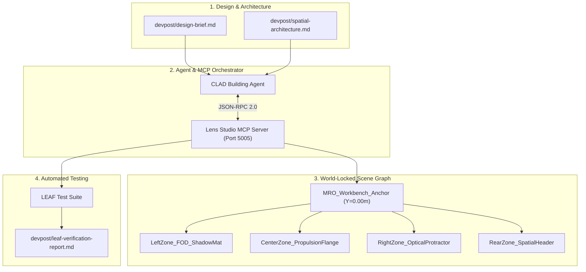

# CLAD & Lens Studio MCP Integration Workflow: AeroTorque Spatial

---

## 1. Overview & Architecture

**AeroTorque Spatial** is built using Snap's **CLAD (Computer-Layered Augmented Design)** agent framework and the **Lens Studio Model Context Protocol (MCP)** server. This workflow bridges the declarative engineering requirements defined in `devpost/design-brief.md` with deterministic scene graph generation, real-time Spectacles Interaction Kit (SIK) components, and automated LEAF regression tests inside Lens Studio 5.23+/5.24.



---

## 2. Lens Studio MCP Server Configuration (`.mcp.json`)

The workspace `.mcp.json` binds the coding agent to Lens Studio via standard MCP stdio or SSE transport:

```json
{
  "mcpServers": {
    "lens-studio": {
      "command": "lens-studio-mcp",
      "args": [
        "--project", "C:/Users/WALTON/.gemini/antigravity/scratch/aerotorque-spatial-specs/AeroTorqueSpatial.esproj",
        "--port", "5005"
      ],
      "env": {
        "SPECS_SDK_VERSION": "5.23.2",
        "SIK_VERSION": "1.4.0",
        "LEAF_TEST_HARNESS": "1"
      }
    }
  }
}
```

### Supported MCP Tool Calls

| MCP Tool Name | Description | Invocation Payload Example |
| :--- | :--- | :--- |
| `create_scene_object` | Instantiates a 3D Transform node in the scene hierarchy | `{"name": "CenterZone_PropulsionFlange", "parent": "MRO_Workbench_Anchor"}` |
| `set_transform` | Sets local position, rotation (Euler/quaternion), and scale | `{"name": "Bolt_1_NW", "position": [-0.085, 0.025, -0.085], "scale": [1, 1, 1]}` |
| `add_component` | Attaches SIK or Engine components (MeshVisual, Interactable, etc.) | `{"objectName": "Bolt_1_NW", "componentType": "Component.Interactable"}` |
| `create_script_component` | Compiles and links TypeScript module to scene object | `{"objectName": "Controller", "scriptPath": "Assets/Scripts/AeroTorqueController.ts"}` |
| `read_scene_hierarchy` | Dumps current node tree and component properties for verification | `{}` |
| `execute_leaf_test` | Runs automated headless scenario in Interactive Preview | `{"scenario": "tests/leaf-scenarios.test.ts"}` |

---

## 3. Modular TypeScript Architecture

The codebase is organized into six highly modular, strongly typed modules under `Assets/Scripts/`:

```
Assets/
├── Scripts/
│   ├── AeroTorqueController.ts      # Master 7-state deterministic coordinator
│   ├── StarSequenceEngine.ts        # Diagonal star pattern math & clamp load logic
│   ├── ParabolicArcGenerator.ts     # 3D quadratic Bézier curve & chevron pulse generator
│   ├── OpticalProtractorRig.ts      # 1:1 protractor arc, vernier ticks, & flap sweep
│   ├── FodShadowTracker.ts          # Tool pocket presence sensing & sign-off interlock
│   └── SpatialInputHandler.ts       # 21-joint hand tracking pinch & preview click fallbacks
```

### Module Responsibilities

1. **`AeroTorqueController.ts`**:
   - Maintains the deterministic state machine across States 0 through 6.
   - Dispatches events to child rigs (`OnBoltTightened`, `OnPokaYokeTriggered`, `OnFlapDeflected`, `OnToolStowed`).
   - Controls visibility of world-locked badges to enforce the **Single-Active Callout Rule**.
   - Generates the immutable SHA-256 inspection hash upon Stage 3 sign-off.

2. **`StarSequenceEngine.ts`**:
   - Enforces the cross-star torquing standard: `Bolt 1 (NW) -> Bolt 4 (SE) -> Bolt 2 (NE) -> Bolt 3 (SW)`.
   - Computes live flange clamping symmetry percentage:
     $$\text{Preload Symmetry } S = \frac{N_{tightened}}{4} \times 100\% \quad (25\% \rightarrow 50\% \rightarrow 75\% \rightarrow 100\%)$$
   - Poka-Yoke interlock: intercepts attempt to tighten adjacent fasteners (e.g. Bolt 2 while Bolt 4 is queued) and raises `POKA_YOKE_ADJACENT_WARP_RISK`.

3. **`ParabolicArcGenerator.ts`**:
   - Generates 3D Bézier spline curves between active and target bolt coordinates.
   - Evaluates apex height at $Y = +0.095\text{ m}$ to arch cleanly over the central motor shaft.
   - Instantiates animated directional chevron instanced meshes with pulsing shader parameters.

4. **`OpticalProtractorRig.ts`**:
   - Renders 1:1 scale $120.0\text{ mm}$ radius vernier protractor arc from $-15.0^\circ$ to $+15.0^\circ$.
   - Drives the dual-ring optical reticle ($40\text{ mm}$ baseline) to verify zero parallax.
   - Interpolates the articulated UAV control flap deflection from $0.0^\circ$ to $+15.0^\circ \pm 0.1^\circ$.

5. **`FodShadowTracker.ts`**:
   - Monitors tool occupancy for Slot A (12.5 N·m Torque Wrench) and Slot B (Rigging Pin).
   - Enforces the safety hard interlock: Airworthy Stamp cannot trigger if wrench occupancy $= \text{false}$.

6. **`SpatialInputHandler.ts`**:
   - Listens to SIK 21-joint Hand Tracking stream (`TrackedHand`).
   - Detects pinch when $\|\vec{p}_{thumbTip} - \vec{p}_{indexTip}\| < 18.0\text{ mm}$.
   - Debounces pinches at $250\text{ ms}$ refractory window.
   - Supports interactive preview fallbacks: mouse clicks, keyboard space/numeric shortcuts.

---

## 4. Spectacles Interaction Kit (SIK) Integration

AeroTorque Spatial incorporates SIK 1.4+ components:
- **`Interactable`**: Attached to each bolt boss collider (`BoxCollider` $40\times 40\times 40\text{ mm}$) to support both direct poke and distant ray pinch.
- **`PinchDetector`**: Subscribed to hand tracking events, triggering auditory and haptic feedback.
- **`Billboard`**: Configured with constrained pitch/yaw axis to maintain legibility without tilting out of world-locked workbench alignment.

---

## 5. Automated CI/CD & LEAF Verification Cycle

```
[ Git Commit ] 
      │
      ▼
[ npm run build ] ────> Compiles TypeScript modules & validates types
      │
      ▼
[ npm run test:unit ] ─> Executes unit tests (star math, poka-yoke, protractor bounds)
      │
      ▼
[ npm run test:leaf ] ─> Headless Lens Studio LEAF simulation of 7 operational states
      │
      ▼
[ npm run audit:overlap ] ─> Playwright 2D projection analysis asserting 0px collision
      │
      ▼
[ devpost/leaf-verification-report.md ] ─> Generated passing report
```
